# Kit visual

Tudo em `src/art/`, feito só com SVG, CSS e Canvas (não há bitmaps nem API de imagem). Os componentes são React + TS puros: não leem estado do jogo, recebem tudo por props e se pintam com os tokens CSS.

Revisão: `npx vite` e abrir `/src/art/gallery.html`. Para ver um asset grande, use `?solo=analyst`, `?solo=analyst&mood=alert`, `?solo=icons&size=120&from=0&n=24`, `?solo=logo` ou `?solo=ops`.

## Direção

Thriller sério de inteligência: dossiê, satélite, terminal, tinta e papel queimado. A base é escura e fria (tinta), com **um acento quente** (âmbar `--sl-warm`, e vermelho-sinal `--sl-signal` para perigo) e **um acento frio** (ciano de radar `--sl-cold`). O papel (`--sl-paper`) aparece só em documentos.

- Âmbar marca o que é do jogador ou pede ação (dinheiro, Contrato, destaque).
- Ciano é informação, sensor, Estação, Analista.
- Vermelho-sinal é Ameaça, Inimigo do Estado, Tensão alta. Não use como decoração.

## Uso

```ts
import './art/tokens.css';            // uma vez, na raiz do app (ou importe de './art', que já carrega)
import { GameIcon, Logo, NoiseBackdrop, DossierFrame } from './art';
```

O `@import` do Google Fonts está no topo de `tokens.css` (Barlow Condensed, IBM Plex Sans, JetBrains Mono, Special Elite).

## Tokens (`tokens.css`, `tokens.ts`)

Três camadas: primitivos `--sl-p-*`, semânticos `--sl-*`, de componente `--sl-c-*`. Componentes só usam semânticos e de componente, então para trocar tema basta redefinir os semânticos num seletor.

| Grupo | Tokens |
|---|---|
| Superfícies | `--sl-bg`, `--sl-bg-deep`, `--sl-surface`, `--sl-surface-raised`, `--sl-line`, `--sl-line-strong` |
| Texto | `--sl-text` (14.9:1), `--sl-text-muted` (6.6:1), `--sl-text-faint` (só decorativo) |
| Acentos | `--sl-warm`, `--sl-signal`, `--sl-cold`, `--sl-ok`, `--sl-on-*` para texto sobre eles |
| Papel | `--sl-paper`, `--sl-paper-ink` (14:1), `--sl-paper-ink-muted` (5.6:1), `--sl-stamp-red`, `--sl-redact` |
| Tipo | `--sl-font-display` / `-body` / `-mono` / `-type`; escala `--sl-fs-2xs` (11) … `--sl-fs-4xl` (64) |
| Espaço / raio | `--sl-space-1…16` (base 4), `--sl-touch: 44px`, `--sl-radius-0…3` (quase reto: dossiê não usa pílula) |
| Sombra / brilho | `--sl-shadow-1…3`, `--sl-shadow-paper`, `--sl-glow-warm/cold/signal` |
| Motion | `--sl-dur-instant…scene`, `--sl-ease-out` (entrada), `--sl-ease-in` (saída, mais rápida), `--sl-ease-stamp` |
| Camadas | `--sl-z-backdrop/map/hud/drawer/modal/toast` |

Com `prefers-reduced-motion`, as durações viram 0. Em TS: `palette`, `color`, `font`, `motion` (com `motion.gsap` para o GSAP), `prefersReducedMotion()`, `prefersLiteRendering()`, `hexToRgb01()`.

Texto: corpo nunca abaixo de 12px; 11px só em rótulo mono maiúsculo.

## Logo (`Logo.tsx`)

- `<Logo variant="full|horizontal|compact|mark" height={64} tagline="…" />`
- `<Monogram size={48} />`: o "S" de estêncil feito de três linhas de livro-razão; a do meio é âmbar e o ponto ciano é um contato de radar. É só caminhos, sem depender de fonte.
- `appIconSvg(512 | 192, { maskable })` devolve a string SVG para o manifest PWA, e `appIconDataUrl()` devolve a `data:` URL. A versão maskable mantém o monograma na zona segura.

## Ícones (`icons/`)

`<GameIcon id="tank3" size={20} accent="warm|cold|signal|ok|none|<cor>" title="…" />`

- Grade 24×24, traço `currentColor` e um único acento por ícone. O traço afina sozinho acima de 24px, e a partir de 40px aparece uma camada de detalhe (rebites, painéis).
- Sem `title` o ícone é decorativo (`aria-hidden`). Num botão só de ícone, passe `title` ou um `aria-label` no botão.
- `iconSvgString(id, { size, color, accent })` dá o SVG autônomo, para canvas, d3 ou ``.
- IDs:
  - Todos os itens de `src/game/data/items.ts`, com os mesmos IDs: `bodyguard` … `nuclear`.
  - Pessoal: `director`.
  - Frota e carga: `fleet`, `crate`.
  - Estações: `station-cell|safehouse|office|compound|base`; o array `STATION_TIER_ICON[nível]` indexa por nível.
  - Postura: `reputation`, `stance-ally|neutral|enemy`.
  - Sistemas: `exposure`, `threat`, `tension`, `final-crisis`, `contract`, `vault`, `team`, `money`, `event`, `rival`, `clock`, `forecast`, `special-op`, `coup`, `neutralization`.
  - Táticas: `tactic-assault|hold|infiltrate|negotiate`.
  - Combate: `combat-legal|urban|army|air`.
  - Estados: `seized`, `detained`, `abducted`, `wounded`, `damaged`.
- `CLASS_ICON[cls]` dá o ícone representativo de cada `UnitClass`. As patentes 1–3 aparecem como barras no canto superior esquerdo (advogados, Agentes de Influência, cargueiros).

## Fundos (`backdrops.tsx`)

Todos são camadas `position:absolute; inset:0` (exceto o radar) e `pointer-events:none`. O pai precisa de `position: relative`.

- `<NoiseBackdrop grain vignette scanlines roll tint="none|warm|cold" fill />` gera um ladrilho de grão uma vez num canvas e o anima só com `transform`, o que custa ~0 por quadro. O grão fica estático com reduced-motion ou em aparelho fraco (Save-Data, ≤2 GB de memória ou ≤2 núcleos).
- `<RadarSweep size period tone blips={[{x,y,tone}]} />` desenha o feixe com `conic-gradient`, e os contatos acendem quando o feixe passa.
- `<DossierPaper burn stain fold seed tilt lite>` aplica fibra, manchas e borda queimada com filtros SVG (`feTurbulence` + `feDisplacementMap`). `lite` (automático em aparelho fraco) usa só gradiente. O padding cresce com `burn`, para o texto não cair no queimado.
- `<WorldGlow tension={0..1} spots={[{x,y,tone,r}]} grid />` vai atrás do mapa. A luz central vai de ciano a âmbar a vermelho conforme a Tensão Global, e os focos pulsam onde há crise.

## Retratos (`portraits.tsx`)

- `<AnalystPortrait mood="neutral|concerned|alert|pleased" speaking blink size />` é a Analista, personagem fixa: ilustração noir com luz de monitor ciano de um lado e luz quente do outro. O LED do fone muda com o humor (âmbar, vermelho no alerta, ciano quando satisfeita). `speaking` anima a boca e `blink` pisca; os dois param com reduced-motion.
- `<OperativePortrait seed tone="cold|warm|paper|signal" code name status frame />` usa o DiceBear `notionists`, com duotone, meio-tom, régua de altura, ficha de papel, clipe e tarja de código. `status` sobrepõe um carimbo (`DETIDO`, `FERIDA`…) e `frame={false}` deixa só a foto quadrada, para listas. O avatar fica em cache por seed.

### Diretor por Origem (`directors.tsx`)

- `<DirectorPortrait origin="field-agent|banker|colonel|diplomat|smuggler|sigint" mood="neutral|concerned|alert|pleased" size crop="head|bust" background blink />` é a ilustração vetorial de cada Origem de `docs/ORIGENS.md`. Usa o mesmo rig de rosto da Analista, mas cada Origem tem cabelo, roupa, acessórios (cicatriz, caneta-tinteiro, quepe sem insígnia, óculos e lenço, cigarro apagado, fones e tela refletida), luz rasante e fundo próprios.
- Até 72px o enquadramento fecha na cabeça e fica quadrado, para o ícone de 48px no topo da tela de jogo. Acima disso mostra o busto em 5:6.
- `<DirectorCard origin selected width={320} />` é o cartão de seleção com moldura de dossiê, número e nome da Origem. O texto de Vantagem e Desvantagem fica com quem usa.
- `ORIGIN_INFO[origin]` traz `label` (pt-BR), `labelEn` e `emblem`, o ID do `<GameIcon>` da Origem (`origin-field-agent` … `origin-sigint`), para marcar Vantagem e Desvantagem. `DIRECTOR_ORIGINS` lista as 6 na ordem do documento.

## Moldura (`frame.tsx`)

- `<DossierFrame label code tone surface="solid|glass|none">` é o painel de HUD com cantos de dossiê e cabeçalho rotulado. `<CornerBrackets />` dá os cantos avulsos.
- `<Stamp text="CONFIDENCIAL|INTERDITADA|DETIDO|SEQUESTRADO|APROVADO|ARQUIVADO|URGENTE|…" sub color rotate size animate wear />` é um carimbo com tinta falhada (máscara de ruído). `animate` dá a batida com overshoot.
- `<Redacted revealed>texto</Redacted>` é uma tarja que acompanha a quebra de linha; o leitor de tela ouve "[censurado]". `<RedactionBar width />` é uma linha censurada avulsa.
- `<Divider variant="rule|ticks|perforation|hazard" label tone />`, `<ClassificationBar level="restrito|secreto|ultrassecreto" caveat />` e `<Tape />`.

## Desempenho e celular (ADR 0003)

- Animações só com `transform`/`opacity`. Nada roda em JS por quadro.
- Os filtros SVG mais caros (papel, carimbo) são estáticos e o navegador os pinta uma vez. Evite muitos `DossierPaper` animados ou redimensionando ao mesmo tempo; em listas longas use `lite`.
- Ícones legíveis a 20px. Alvos de toque são responsabilidade de quem usa: envolva o ícone num botão de pelo menos 44px.

## PWA

- Os ícones ficam em `public/icons/`: `icon-192.png`, `icon-512.png`, `icon-maskable-512.png` (monograma a 50%, dentro da zona segura), `apple-touch-icon.png` (180), `favicon-32.png` e `favicon.svg`. Os SVG de origem são `icon.svg` e `icon-maskable.svg`, gerados por `appIconSvg()`.
- Para regenerar depois de mudar o logo, exporte `appIconSvg(512)` e `appIconSvg(512, { maskable: true })` para os SVG (com `npx -y tsx`) e rasterize com `npx -y @resvg/resvg-js-cli --fit-width <px> <svg> <png>`. Nada disso entra no `package.json`.
- As screenshots do manifest ficam em `public/screenshots/*.webp` (1280×720, `form_factor: wide`) e foram capturadas do jogo publicado.
- Service worker (`public/sw.js`):
  - A página vai à rede primeiro; o cache é a reserva offline.
  - `/assets/*` com hash vem do cache primeiro.
  - O resto do site é servido do cache e revalidado em segundo plano.
  - A cada `index.html` novo, os assets de builds antigos são apagados.
  - Só registra fora do servidor de dev (script inline no `<head>` do `index.html`).
  - Mude `SHELL_VERSION` só quando mudar a lógica do SW.

## Componentes de jogo (`game-ui.css`, `game-ui.tsx`)

O pedido foi que a interface parecesse um jogo, e não uma página HTML. O sistema `.g-*` dá volume, corte chanfrado e resposta física aos controles. As classes funcionam direto em JSX, e os componentes React são atalhos que já tocam o som de UI pela API existente (`audio.sfx('click' | 'hover')`).

### Auditoria (jogo publicado em 1440×900 e 440×956)

| O que parece "página web" | Onde | Correção |
|---|---|---|
| Botões planos de formulário (retângulo âmbar liso, contorno de 1px) sem volume nem estado de pressionado | Comprar, Ver México, Destacar Equipe, `.btn` em geral | `.g-btn` com bisel, aro duplo, sombra que comprime e desce 2px ao pressionar, brilho âmbar no hover |
| Desabilitado só com opacidade 38%, que parece "carregando" | Comprar sem caixa/espaço | Face apagada com tarja diagonal; continua legível |
| Toggles de camada e velocidade como caixas soltas de borda fina | Postura/Exposição/Política, 1×/2×/4×/8× | `.g-seg`: trilho rebaixado com a opção ativa em relevo âmbar |
| Abas sublinhadas (navegação de site) e pílulas que transbordam | Frota/Carga/…; Oportunidades/Armamento | `.g-tabs`/`.g-tab` como fichário: trapézio, a ativa encosta no corpo, filete âmbar no topo |
| Seções separadas só por um fio; superfícies todas iguais | Painéis de país e agência | `.g-panel` com chanfro, rebites, marca de registro âmbar, textura de chapa e cabeçalho com marca |
| Traços como `<span>` com contorno verde | Persuasivo, Modesto | `.g-chip`: etiqueta com furo, em tons de sistema |
| Barras finas e cinza, sem escala | Reputação, Exposição, Espaço, Tensão | `.g-meter` com trilho rebaixado, marcas de 10%, borda de avanço e limiar |
| Números sem algarismos tabulares em alguns lugares; títulos em sans de documento | barra superior, nome do país | `.g-counter` (tabular, unidade menor, pisca verde/vermelho ao mudar); `.g-title` (Archivo largura 75%, caixa alta) |
| "?" de 16px abaixo da área de toque mínima | Reputação?, Exposição?, Carga? | `.g-help`: 20px visíveis e 44px de toque |
| Menu principal como lista de links | Menu | `.g-menu-item`: marcador ▶ que desliza, faixa âmbar, som |

Antes, no jogo publicado:

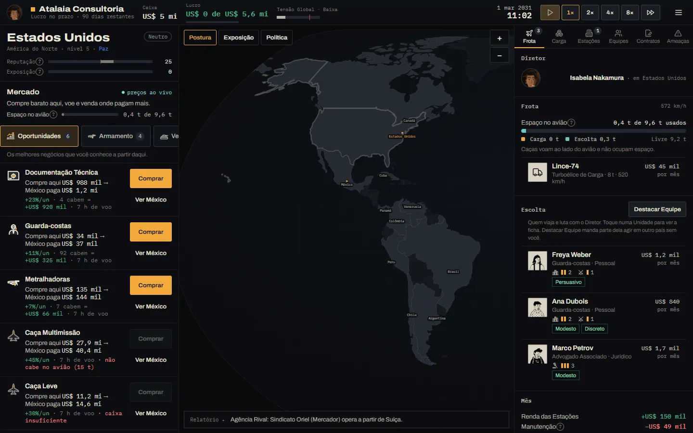

Depois, com a mesma tela recriada com `.g-*` (`?solo=game` na galeria):

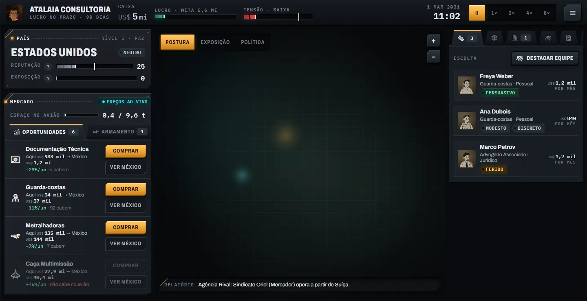

Ponte `.g-skin` aplicada ao jogo real, sem mudar o JSX: só os `.btn` mudam.

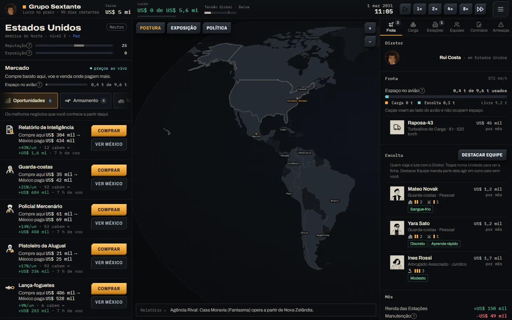

Kit em 1280 e em 440:

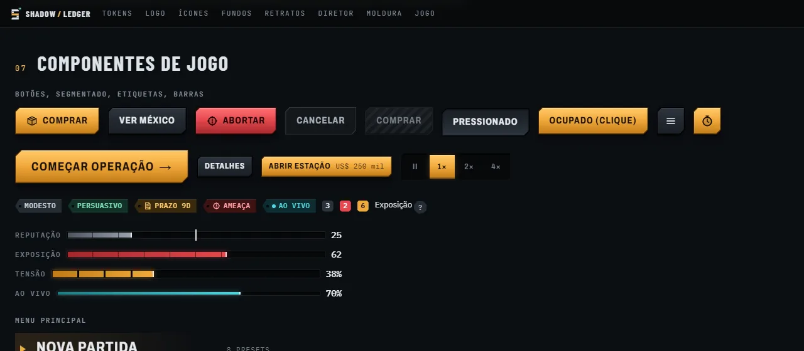
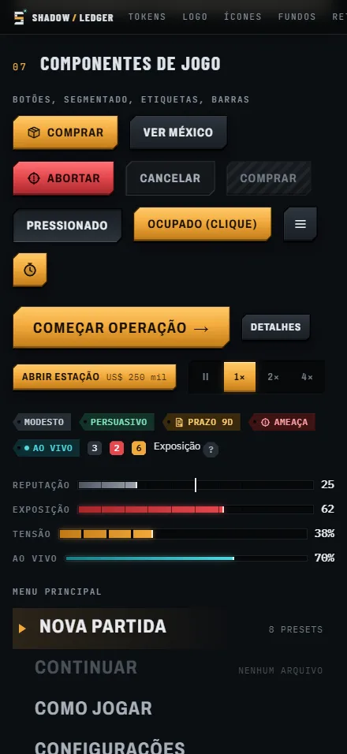

### Paleta de jogo (hierarquia)

| Papel | Token | Uso |
|---|---|---|
| Fundo | `--g-bg` #090b0e | atrás de tudo |
| Superfície | `--g-surface` #11151a | painéis |
| Elevada | `--g-raised` #181d23 | topo dos painéis, corpo das abas |
| Controle | `--g-control` #222930 | face dos botões secundários |
| Rebaixado | `--g-sunken` #06080a | trilhos de barra e de segmentado |
| Texto | `--g-text` 15:1 · `--g-text-2` 8,2:1 · `--g-text-3` 4,6:1 (só rótulo) | |
| Ação | `--g-action` #f2a93b (texto `--g-on-action`, 10:1) | o que o jogador pode fazer |
| Perigo | `--g-danger` #e5484d | Abortar, Ameaça, Exposição alta |
| Ao vivo | `--g-live` #4fd8e0 | **só** preços ao vivo, radar, espaço em tempo real |
| Ganho | `--g-ok` #46b98d | lucro, traço positivo |

Motion: pressionar em 80ms e transições de cor/brilho em 140ms; com reduced-motion fica sem animação.

### Classes e componentes

| Classe | Componente | Variantes |
|---|---|---|
| `.g-btn` | `<GButton variant size icon iconEnd sub block busy sfx>` | `--primary` `--secondary` (padrão) `--danger` `--ghost`, `--sm` `--lg` `--block` `--icon`; estados `:disabled`, `.is-pressed`, `.is-busy` |
| `.g-btn--icon` | `<GIconButton label icon>` | `label` vira `aria-label` |
| `.g-seg` + `.g-seg__opt[aria-checked]` | `<GSegmented options value onChange label>` | navegação por setas |
| `.g-panel` + `.g-panel__head/__title/__rule/__code` | `<GPanel label code tone raised pad>` | `--raised` `--sunken` `--alert` `--action` `--paper` |
| `.g-tabs` + `.g-tab[aria-selected]` + `.g-tabbody` | `<GTabs items value onChange label compact>` | `--alert`; setas, Home e End |
| `.g-chip` | `<GChip tone icon>` | `--ok` `--warn` `--danger` `--live` (ponto pulsando) |
| `.g-badge` | `<GBadge tone>` | `--alert` `--action` |
| `.g-meter` + `.g-meter__fill` (`--v` 0..1) + `.g-meter__mark` (`--m`) | `<GMeter value max tone segmented thin mark label valueText>` | `--danger` `--live` `--ok` `--neutral`, `--segmented` `--thin` |
| `.g-counter` | `<GCounter value format unit suffix signed flash size>` | `--lg`, `.is-up`/`.is-down` |
| `.g-row` | — | linha de lista com faixa âmbar no hover e na seleção; `--off` |
| `.g-menu-item` | `<GMenuItem label meta current>` | |
| `.g-help` | `<GHelp label>` | |
| `.g-title`, `.g-label` | — | título de seção, rótulo mono |

**Ponte `.g-skin`.** Com `import './art/game-ui.css'` e a classe `g-skin` num ancestral (por exemplo o `#root` ou `.game`), os botões antigos (`.btn`, `.btn.primary`, `.btn.danger`, `.btn.ghost`, `.btn.sm`, `.btn.icon`) ganham o visual de `.g-btn` sem trocar o JSX. É o caminho mais curto para a tela de jogo; o resto (abas, chips, barras) se adota trocando a classe.

### Adoção: atual → novo

| Atual | Novo |
|---|---|
| `button.btn` / `.btn.primary` / `.btn.danger` / `.btn.ghost` / `.btn.sm` / `.btn.icon` | `g-skin` no ancestral (ponte) ou `.g-btn` + `--primary/--danger/--ghost/--sm/--icon` |
| `.map-modes button` (Postura/Exposição/Política) | `<GSegmented>` ou `.g-seg` > `.g-seg__opt[aria-checked]` |
| `.tb-speed` (pausa, 1×–8×) | `.g-seg`; pausa com `.g-seg__opt` usando ícone |
| `.map-zoom` (+ / −) | `.g-btn.g-btn--icon.g-btn--sm` |
| `.tabs` / `.tab` / `.badge` (painel da agência) | `.g-tabs` / `.g-tab` / `.g-badge` (`--alert` quando `.hot`) e corpo `.g-tabbody` |
| abas de categoria do Mercado (`.mk-head` pílulas) | `<GTabs>` com `icon` e `count` |
| `.sec` / `.sec-head` (seções do painel) | `.g-panel` + `.g-panel__head` |
| `.chip`, `.trait`, `.status` | `.g-chip` (`--ok` traço bom, `--warn` Ferido/Danificado, `--danger` Detido, `--live` "preços ao vivo") |
| `.meter` / `.meter-fill`, `.cap-bar`, `.tension` / `.tension-fill` / `.tension-mark` | `.g-meter` (`--v`) + `.g-meter__mark` (`--m`); Tensão `--danger --segmented` |
| `.tb-v`, `.num` (valores da barra) | `.g-counter` (`--lg` na barra superior) |
| `.cty-title` (nome do país) | `.g-title` |
| `.mk-row`, `.unit-row`, `.station-row` | `.g-row` (`aria-selected` ou `.is-selected`) |
| `?` de glossário | `.g-help` |
| menu: `.slm-nav-item` | `<GMenuItem>` / `.g-menu-item` (`.g-menu-item__meta` no lugar de `.slm-nav-meta`) |
| menu: `.slm-btn--primary` / `.slm-btn--ghost` (no papel) | `.g-btn--primary` / `.g-btn--ghost` dentro de `.g-panel--paper`, ou só a ponte |
| menu: `.slm-seg` / `.slm-seg-btn` | `.g-seg` / `.g-seg__opt` |
| menu: `.slm-icon-btn` | `.g-btn--icon` |

## Componentes de jogo, fase 2 (`game-ui-2.css`, `game-ui-2.tsx`)

`game-ui.css` já carrega `game-ui-2.css` (via `@import`), então um único import cobre as duas fases. A ponte `.g-skin` também ganhou uma fase 2 que melhora as classes atuais **sem mexer em layout**: muda fundo, borda, sombra, tipografia e pseudo-elementos, mas não display, tamanho nem posição.

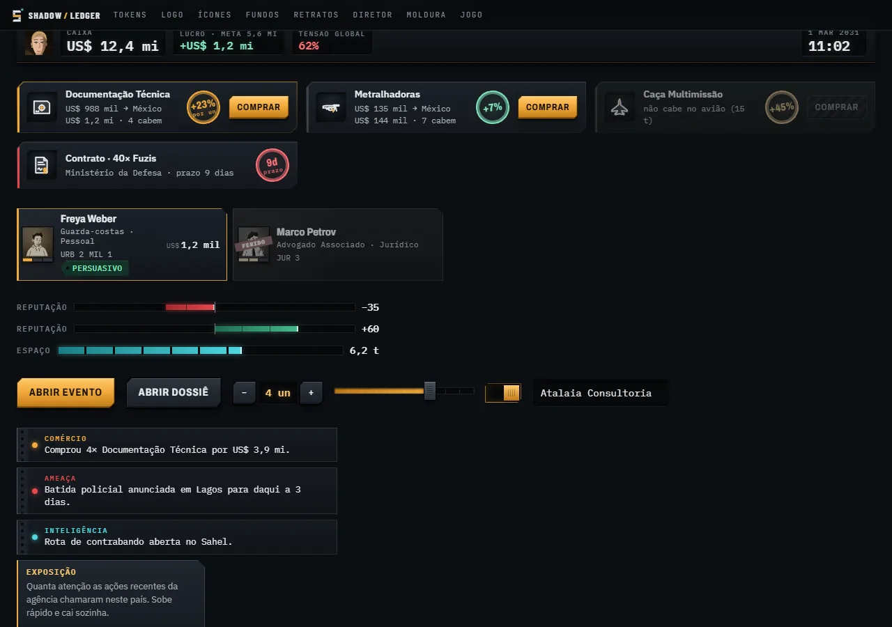
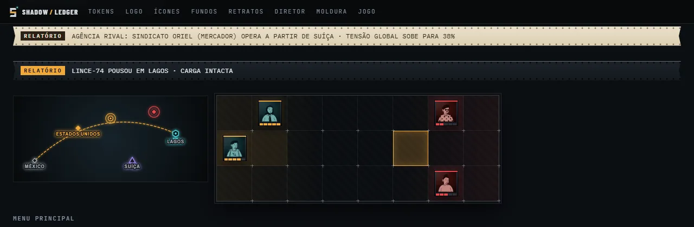

Ponte da fase 2 no jogo real (build de `main` com `g-skin`):

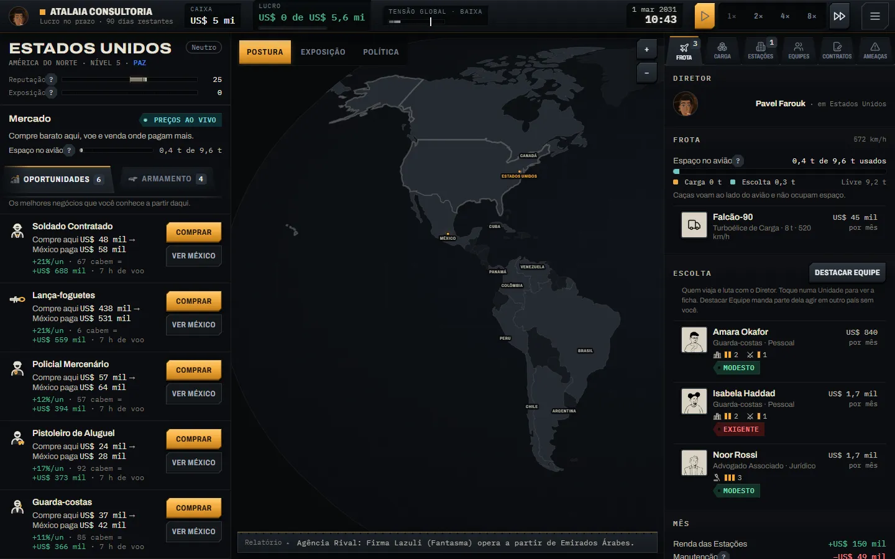
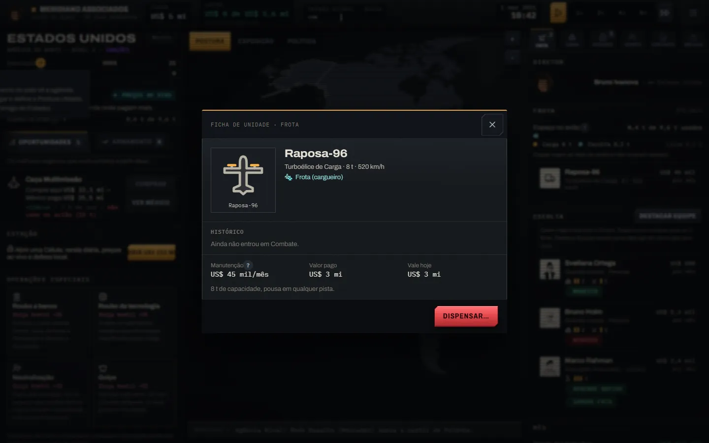
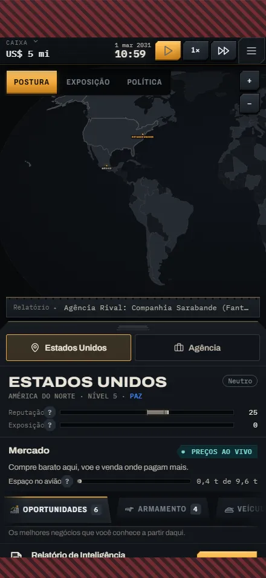
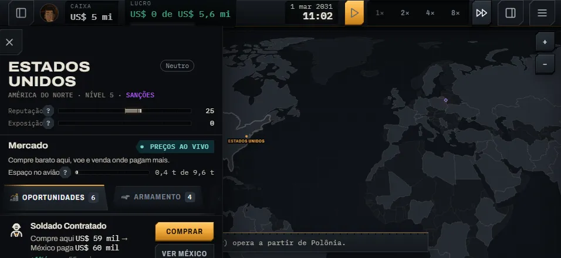

| Peça | Classe | Componente |
|---|---|---|
| Barra superior como HUD | `.g-hud` | — |
| Mostrador (caixa, lucro, data) | `.g-dial` + `__k` / `__v`, `--ok/--danger/--action/--lg` | `<GDial label tone size>` |
| Folha inferior | `.g-sheet` + `.g-grip` (pega de chapa estriada) | — |
| Gaveta lateral | `.g-drawer` (`--right`) | — |
| Ficha de Mercado/Oportunidade | `.g-card` (`--hot/--danger/--off`) + `.g-well` (poço do ícone) + `__title/__meta` | `<GCard icon title meta seal sealTone actions tone>` |
| Selo carimbado | `.g-seal` (`--ok/--danger/--sm`) | `<GSeal>` |
| Carta de Unidade | `.g-unit` (`.is-selected`, `--out` com `data-status`) + `__portrait` + `__rank > i.on` + `__name/__role/__stats` | `<GUnitCard portrait name role rank stats side selected out onClick>` |
| Medidor bipolar (Reputação) | `.g-meter--bipolar` com `--from` | `<GMeter value={rep+100} max={200} bipolar>` |
| Modal de comando / dossiê | `.g-modal-scrim` + `.g-modal` (`--good/--bad/--intel/--dossier`) + `__bar/__kicker/__title/__body/__foot` | `<GModal open onClose kicker title tone variant actions>` (Esc fecha, som de abrir e fechar) |
| Teletipo | `.g-toast` (`--good/--ok/--bad/--intel`) + `__k` | `<GToast tone kicker>` |
| Dica / glossário | `.g-tip` + `__k` | `<GTip kicker>` |
| Campo | `.g-input` | — |
| Fader | `.g-range` (`--p` = preenchimento) | `<GRange value min max onChange>` |
| Stepper | `.g-stepper` + `__v` | `<GStepper value min max step onChange format>` |
| Interruptor | `.g-toggle[aria-checked]` | `<GToggle checked onChange label>` |
| Marcadores do mapa (SVG) | `.g-mapmark--station/rival/threat`, `.g-maplabel` | `<GMapMarker kind x y inv label tier>` |
| Rota de voo (SVG) | `.g-route` (tracejado andando, brilho) | — |
| Tabuleiro de Combate | `.g-board` (`--cols/--rows`) + `__cell--deploy/target/enemy` (cruzes de registro) | `<GBoard cells>` |
| Carta no tabuleiro | `.g-token` (`--enemy`) + `__card` + `__hp > i.on` | `<GToken portrait hp hpMax enemy col row>` |
| Relatório como telex | `.g-telex` (`--dark`) + `__k/__t` | `<GTelex kicker dark>` |

### Ponte `.g-skin`, fase 2 (automática)

Barra superior (`.topbar`, `.tb-k`, `.tb-name`, `.tb-time`; a partir de 900px `.tb-stat/.tb-clock` viram mostradores), `.cty-title`, `.sec`/`.sec-head h3`, todos os medidores antigos (`.meter`, `.cap-bar`, `.tension`, `.mkt-cap-bar`, `.fs-bar`, `.uc-s-bar`), `.unit-row` (carta; `.sel` com faixa âmbar), retratos em `.unit-row`/`.uc`, `.scrim`, `.event-card`, `.ud` e `.ud-scrim` (com `g-skin`), `.toast` (teletipo), `.help-btn`/`.help-pop`, `.gsheet` e `.gsheet-grip`, `.map-label`, os marcadores `.pin/.threat-pin/.rival` (brilho), a rota de voo tracejada (anda), `.log` (telex escuro), `.grid/.cell/.token` (tabuleiro), `.op` (ficha de missão) e o hover de `.mkt-row`.

### Troca recomendada (fase 2)

| Atual | Novo |
|---|---|
| `.tb-stat` / `.tb-clock` | `<GDial>` (no estreito, `.g-dial` sem rótulo ou só o valor) |
| `.topbar` | `.g-hud` |
| `.gsheet` / `.gsheet-grip` | `.g-sheet` / `.g-grip` |
| gavetas laterais (`.side`, `.side-e`, `.agency`) | `.g-drawer` / `.g-drawer--right` |
| `.mkt-row`, `.opp-item` / `.opp-body` | `<GCard icon seal actions>`; a margem vai no `seal`, e "não cabe" vira `tone="off"` |
| `.op` (Operação Especial) | `<GCard tone="danger" icon="special-op" seal="~25" sealSub="hostil">` |
| `.unit-row` / `.uc` | `<GUnitCard>` (patente nas barras, `out="DETIDO"`/`"FERIDA"`) |
| Reputação (`.meter` + `.meter-mid`) | `<GMeter bipolar value={rep+100} max={200}>` |
| `.event-card` + `.scrim` | `<GModal tone="good/bad/intel">`; "big" = `width={560}` |
| `.ud` (ficha de Unidade) | `<GModal variant="dossier">` ou mantém `.ud` com a ponte |
| `.toast.tone-*` | `<GToast tone kicker>` |
| `.help-pop` | `.g-tip` (`.g-tip__k` = termo do glossário) |
| `.stepper`, `.mkt-stepper`, `.mkt-range` | `<GStepper>`, `<GRange>` |
| interruptores do menu (`.slm-toggle`) | `<GToggle>` |
| marcadores no `WorldMap` (círculos e losangos inline) | `<GMapMarker kind inv>`; rota com `className="g-route"` |
| `.grid` / `.cell` / `.token` | `<GBoard>` / `<GToken>` |
| `.log` / `.log-peek` | `<GTelex kicker dark>` |
